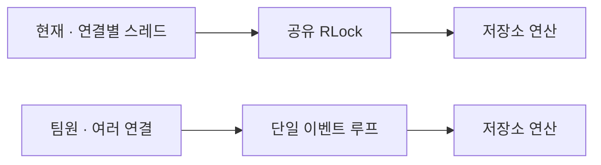
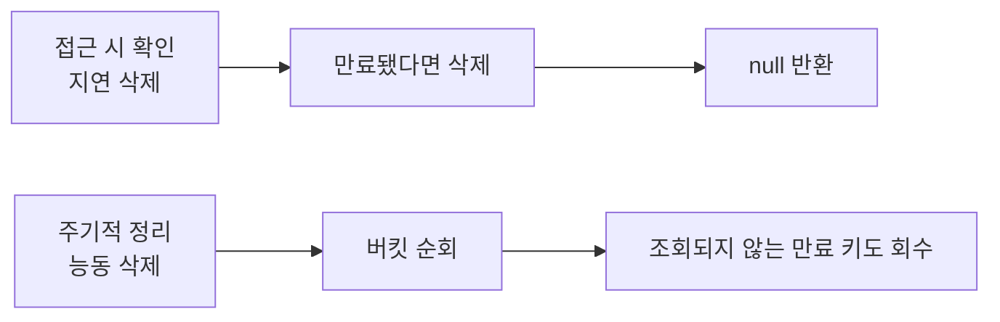
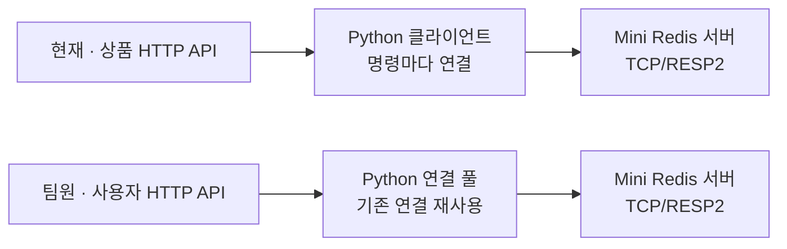
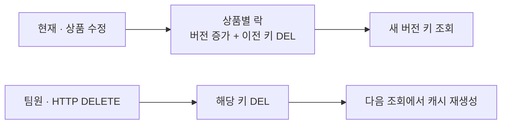

# Mini Redis

### 정글 가이드라인의 다섯 기준으로 비교한 두 구현

AI를 활용해 개발을 마친 뒤, 구현 방식과 장단점을 비교해 최종 구현을 선택했습니다.

**현재 구현: Python · 이 저장소** / **팀원 구현: C · 비교 저장소**

<a id="roadmap"></a>

**살펴볼 순서**

전체 구조 → **① 동시성 → ② 만료 처리 → ③ 외부 API → ④ 무효화 → ⑤ 서버 장애 시 보존** → 선택 이유

<a id="overview"></a>

## 전체 구조


**현재 구현의 해시 테이블:** FNV-1a → 연결 리스트로 충돌 처리 → 부하율 0.75 초과 시 2배 확장

---

<a id="concurrency"></a>

## 1. 동시성

**문제: 여러 요청의 저장소 연산이 서로 끼어들지 않게 하려면?**



| 비교 | 현재 구현 · Python | 팀원 구현 · C |
|---|---|---|
| **처리 방식** | 여러 스레드 → 공유 락으로 접근 조정 | 한 스레드 → 명령을 하나씩 끝까지 실행 |
| **장점** | 요청 처리와 저장소 보호를 분리 | 저장소 락·연결별 스레드 불필요 |
| **비용·한계** | 스레드 비용·전역 락 경합 | 긴 작업이 이벤트 루프 지연 |

> **비교 핵심: 둘 다 개별 명령의 원자성을 제공한다.**
> `INCR`는 보호하지만, 클라이언트의 `GET → 계산 → SET` 전체는 보호하지 않습니다. 현재 구현도 저장소 연산은 순차 실행합니다.

<a id="expiration"></a>

## 2. 만료 처리

**문제: 만료된 값의 반환을 막고, 사용하지 않는 키의 메모리도 회수하려면?**



**공통 규칙:** 현재 시각 ≥ 만료 시각이면 없는 키. 살아 있는 키는 값 반환, 없는 키는 null 반환.

| 비교 | 현재 구현 · Python | 팀원 구현 · C |
|---|---|---|
| **처리 방식** | 지연 삭제 + 배경 스레드의 능동 삭제 | 지연 삭제 + 이벤트 루프의 능동 삭제 |
| **장점** | 만료 응답 방지 + 메모리 회수 | 만료 응답 방지 + 메모리 회수 |
| **비용·한계** | 정리 중 공유 락 점유 | 정리 중 이벤트 루프 점유 |

> **비교 핵심: 같은 전략이며, 정리를 실행하는 위치가 다르다.**
> 지연 삭제만 하면 미조회 키가 남고, 능동 삭제만 하면 정리 전 요청에서 만료를 놓칠 수 있습니다. 현재 구현의 GET과 배경 정리는 같은 락을 사용합니다.

<a id="external-api"></a>

## 3. 외부 API

**문제: 다른 프로그램에서 Mini Redis를 쉽게 사용하려면?**



| 비교 | 현재 구현 · Python | 팀원 구현 · C |
|---|---|---|
| **처리 방식** | TCP/RESP2 + HTTP 명령·상품 API | TCP/RESP2 + HTTP 사용자 조회 API |
| **장점** | HTTP로 상품을 조회·수정하고 Redis 명령도 호출 가능 | 조건부 저장(`NX`·`XX`) 지원, 연결 재사용 |
| **비용·한계** | Python 클라이언트가 명령마다 새 연결 | 풀의 연결 반환·오류 처리 관리 필요 |

> **비교 핵심: 두 HTTP API 모두 조회 결과를 캐시하며, Redis 연결을 관리하는 방식이 다르다.**
> 양쪽 모두 외부 호출 구조를 갖췄으며, 전체 Redis 호환이나 성능 우열을 보장하는 비교는 아닙니다.

<a id="invalidation"></a>

## 4. 무효화

**문제: 원본이 바뀐 뒤 이전 캐시를 다시 사용하지 않게 하려면?**



| 비교 | 현재 구현 · Python | 팀원 구현 · C |
|---|---|---|
| **처리 방식** | DEL·TTL + 상품별 락·버전 키 | DEL·TTL·전체 삭제; HTTP DELETE로 캐시 삭제 |
| **장점** | 갱신 중 예전 값 재저장 방지; 삭제 실패에도 옛 버전 키 미사용 | 명시적 삭제와 일괄 삭제 제공 |
| **비용·한계** | 같은 상품 요청이 락 대기; API 한 프로세스 범위 | HTTP 조회·캐시 채우기와 삭제를 함께 조정하지 않음 |

> **비교 핵심: 현재 구현은 원본 수정과 캐시 갱신이 겹치는 상황까지 다룬다.**
> 팀원 데모는 실제 원본 수정 API 없이 캐시 삭제를 시연합니다. 진행 중인 조회가 삭제 후 같은 키를 다시 채울 수 있습니다.

| 저장소의 전역 락 | API의 상품별 락 |
|---|---|
| 개별 Redis 명령 보호 | 같은 상품의 조회·캐시 채우기·수정 과정 조정 |

<a id="persistence"></a>

## 5. 서버 장애 시 데이터 보존 · 선택 항목

**문제: 서버가 갑자기 종료된 뒤 무엇을 복구할 수 있는가?**


| 비교 | 현재 구현 · Python | 팀원 구현 · C |
|---|---|---|
| **처리 방식** | 저장 시점의 상태 기록 → 파일 교체 → 시작 시 로드 | 변경 명령 추가 기록 → 동기화 정책 적용 → 시작 시 재실행 |
| **장점** | 일관된 복사본과 원자적 파일 교체로 스냅샷 저장 | 변경을 계속 기록; always / everysec / no 정책 선택 |
| **비용·한계** | **마지막 저장 이후 변경은 강제 종료 시 유실 가능** | 기록·동기화 비용; 쓰기 실패에도 성공 응답 가능 |

> **비교 핵심: 현재는 저장 시점의 복구, 팀원은 지속적인 변경 기록에 초점.**
> 양쪽 모두 영속성 옵션 설정이 필요합니다. AOF도 동기화 정책·디스크 오류·재생 정확성에 따라 복구 범위가 달라집니다.

---

<a id="selection"></a>

## 종합: 왜 현재 구현을 선택했는가?

**상품 가격을 수정하는 요청 하나로 이전 캐시를 무효화하고, 다음 조회에서 바뀐 가격을 보여주는 구현을 선택했습니다.**

| 중점 포인트 | 비교 판단 |
|---|---|
| ① 동시성 | 둘 다 명령 단위로 보호. 구조만으로 우열을 단정하지 않음 |
| ② 만료 처리 | 같은 전략. 실행 위치와 정리 비용의 차이 |
| ③ 외부 API | 두 구현 모두 HTTP 조회 결과를 캐시. 현재 상품 API는 원본 수정도 지원 |
| ④ 무효화 | **상품별 락 + 버전 키로 조회·수정 경합까지 대응한 점이 주요 선택 이유** |
| ⑤ 데이터 보존 | 팀원의 연속 기록 장점을 인정. 현재의 저장 이후 유실 가능성은 개선 과제 |

**상품 API의 캐시 흐름**　가격 수정 → 첫 조회에서 새 가격을 읽어 저장(`MISS`) → 만료 전 재조회에서 캐시된 가격을 반환(`HIT`)

<details>
<summary>실행 방법 · 비교 근거 · 관련 문서</summary>

Python 3.10 이상에서 프로젝트 루트의 터미널 두 개로 서버를 실행합니다.

```sh
# 터미널 1 · Mini Redis
python3 -m mini_redis.server --snapshot data/snapshot.json
# 터미널 2 · 상품 HTTP API
python3 -m mini_redis.demo
```

다른 터미널에서 `curl -i http://127.0.0.1:8080/products/1`을 호출하면 상품 정보와 `X-Cache` 응답 헤더를 확인할 수 있습니다.

- [발표 대본](docs/PRESENTATION.md) · [실행·구현 상세](docs/REFERENCE.md)
- 현재 구현: [서버](mini_redis/server.py) · [저장소](mini_redis/store.py) · [클라이언트](mini_redis/client.py) · [상품 API](mini_redis/demo.py)
- 현재 검증: [저장소](tests/test_store.py) · [TCP·HTTP](tests/test_network.py) · [재시작](tests/test_lifecycle.py)
- 팀원 비교 기준: [feat/mini-redis-core · bfb1c05](https://github.com/minseongkim275-dotcom/mini-redis/tree/bfb1c0566b00e2b30a03cb5b4c0845e357f0a0e0)
- 팀원 근거: [이벤트 루프](https://github.com/minseongkim275-dotcom/mini-redis/blob/bfb1c0566b00e2b30a03cb5b4c0845e357f0a0e0/src/net/server.c) · [만료](https://github.com/minseongkim275-dotcom/mini-redis/blob/bfb1c0566b00e2b30a03cb5b4c0845e357f0a0e0/src/store/store.c) · [명령](https://github.com/minseongkim275-dotcom/mini-redis/blob/bfb1c0566b00e2b30a03cb5b4c0845e357f0a0e0/src/commands/commands.c) · [클라이언트](https://github.com/minseongkim275-dotcom/mini-redis/blob/bfb1c0566b00e2b30a03cb5b4c0845e357f0a0e0/demo/miniredis_client.py) · [HTTP API](https://github.com/minseongkim275-dotcom/mini-redis/blob/bfb1c0566b00e2b30a03cb5b4c0845e357f0a0e0/demo/api_server.py) · [AOF](https://github.com/minseongkim275-dotcom/mini-redis/blob/bfb1c0566b00e2b30a03cb5b4c0845e357f0a0e0/src/aof/aof.c)

현재 상품 원본은 메모리 예제입니다. TTL의 절대 시각은 시스템 시계 변경의 영향을 받으며, 주기 정리는 만료 직후의 즉시 회수를 보장하지 않습니다.
현재 구현에는 AOF·자동 주기 저장·복제가 없습니다. 비교는 위 고정 커밋 기준입니다.

</details>
