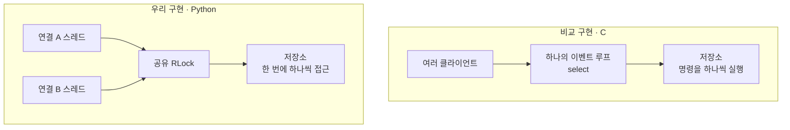
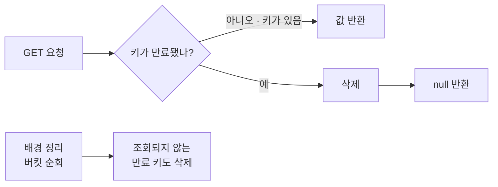

# Mini Redis

### 여러 요청은 안전하게, 만료된 값은 정확하게

직접 만든 해시 테이블 기반의 키·값 저장소 · Python · TCP/RESP2

## 1. 무엇을 만들었나


| 동시성 | 만료 처리 | 외부 API | 무효화 | 데이터 보존 |
|---|---|---|---|---|
| 공유 저장소 + 락 | 접근 시 확인 + 주기 정리 | TCP · HTTP | DEL · 버전 키 | 스냅샷 |

**해시 테이블:** FNV-1a → 연결 리스트로 충돌 처리 → 부하율 0.75 초과 시 2배 확장

## 2. 동시성: 저장소를 변경하는 순서를 보호한다

### 같은 목표, 다른 구조



| | 비교 구현 | 우리 구현 |
|---|---|---|
| 보호 방식 | 한 스레드가 순차 실행 | 여러 스레드의 접근을 락으로 조정 |
| 장점 | 저장소 락·연결별 스레드 불필요 | 요청 처리와 저장소 보호를 분리 |
| 비용 | 긴 작업이 이벤트 루프 지연 | 스레드 비용·전역 락 경합 |

**둘 다 개별 명령의 원자성을 제공. 멀티스레드여도 저장소 연산은 순차 실행.**

### 두 번 증가시켰는데 결과가 1이라면?

초깃값 `counter = 0`

| 읽기·저장이 엇갈리면 | 우리 INCR: 작업 전체를 락으로 보호 |
|---|---|
| A가 0 읽기 → B도 0 읽기 | A: 락 획득 → 0 읽기 → 1 저장 → 해제 |
| A가 1 저장 → B도 1 저장 | B: 대기 → 락 획득 → 1 읽기 → 2 저장 |
| **결과 1 · 증가 유실** | **결과 2** |

> **보장 범위: 단일 프로세스의 개별 명령.**
> 클라이언트의 `GET → 계산 → SET` 조합 전체는 원자적이지 않습니다.

## 3. 만료: 값의 유효성과 메모리 회수

**현재 시각 ≥ 만료 시각 → 없는 키로 취급**



키가 처음부터 없으면 바로 null을 반환합니다.

| 처리 | 목적 | 이것만 사용하면? |
|---|---|---|
| **접근 시 확인** · 지연 삭제 | 만료된 값의 반환 방지 | 다시 조회되지 않는 키가 남음 |
| **주기적 정리** · 능동 삭제 | 만료된 키의 메모리 회수 | 정리 전 요청에서 만료를 놓칠 수 있음 |

> **GET도 데이터를 삭제할 수 있다.**
> 조회·갱신·배경 정리는 모두 같은 저장소 락을 사용합니다.

| 공통점 | 실행 위치의 차이 |
|---|---|
| 두 구현 모두 지연 삭제 + 능동 삭제 | 상대: 이벤트 루프 / 우리: 배경 스레드 + 공유 락 |

## 4. 외부 사용과 데이터 수명

| 외부 API | 무효화 | 데이터 보존 |
|---|---|---|
| 클라이언트 → TCP/RESP2 → Store | 상품 수정 → 버전 증가 → 이전 키 DEL | SAVE·정상 종료 → 스냅샷 → 재시작 복구 |
| HTTP 상품 API에서 캐시로 활용 | 다음 조회는 **새 버전 키** 사용 | **마지막 저장 이후 변경은 유실 가능** |

**두 락의 역할**

| 저장소의 전역 락 | API의 상품별 락 |
|---|---|
| 개별 Redis 명령 보호 | 같은 상품의 캐시 조회·채우기와 수정 조정 |

상품 원본은 메모리 예제입니다. 상품별 락과 버전 키의 보장은 **API 한 프로세스 범위**입니다.
스냅샷은 경로 설정이 필요하며, 자동 주기 저장·AOF·복제는 구현하지 않았습니다.

## 5. 왜 이 구현을 선택하는가

**저장소 내부의 명령 보호부터 API의 캐시 갱신까지 연결한 구현**

| 선택 근거 | 감수한 한계 |
|---|---|
| 사용자 명령과 배경 정리를 같은 락으로 조정 | 전역 락이 처리량의 병목이 될 수 있음 |
| 만료 확인과 메모리 회수를 함께 처리 | 회수 지연·시스템 시계 변경의 영향 |
| 상품별 락과 버전 키로 캐시 갱신 보완 | 여러 API 서버에 걸친 일관성은 미지원 |
| 저장 시점의 상태를 스냅샷으로 복구 | 마지막 저장 이후 변경의 유실 가능성 |

### 구현은 어떻게 확인했나?

| 동시성 | 만료 | API·복구 |
|---|---|---|
| 16개 작업자 × 1,000회 증가 → **16,000** | 가짜 시계로 **만료 직전·정각** 검사 | 캐시 수정·장애 대응 검사 |
| 실제 TCP 동시 요청 검사 | 조회하지 않은 만료 키의 회수 검사 | SAVE 후 강제 종료·재시작 검사 |

**기존 테스트 30개 통과.** 테스트한 시나리오의 결과이며, 두 프로젝트의 성능 우열을 측정한 결과는 아닙니다.

---

<details>
<summary>실행 방법 · 구현 근거 · 관련 문서</summary>

Python 3.10 이상, 추가 패키지 없이 프로젝트 루트에서 실행합니다.

```bash
python3 -m mini_redis.gui
```

[http://127.0.0.1:8080](http://127.0.0.1:8080)에서 GUI를 엽니다. 기본 스냅샷 경로는 `data/snapshot.json`입니다.

- [실행·명령 목록·구현 상세](docs/REFERENCE.md)
- [발표 대본](docs/PRESENTATION.md)
- [서버와 연결 처리](mini_redis/server.py) · [Store·만료·스냅샷](mini_redis/store.py) · [상품 API](mini_redis/demo.py)
- [저장소 테스트](tests/test_store.py) · [통신 테스트](tests/test_network.py) · [재시작 테스트](tests/test_lifecycle.py)
- 비교 대상: [minseongkim275-dotcom/mini-redis · feat/mini-redis-core · bfb1c05](https://github.com/minseongkim275-dotcom/mini-redis/tree/bfb1c0566b00e2b30a03cb5b4c0845e357f0a0e0)

</details>
